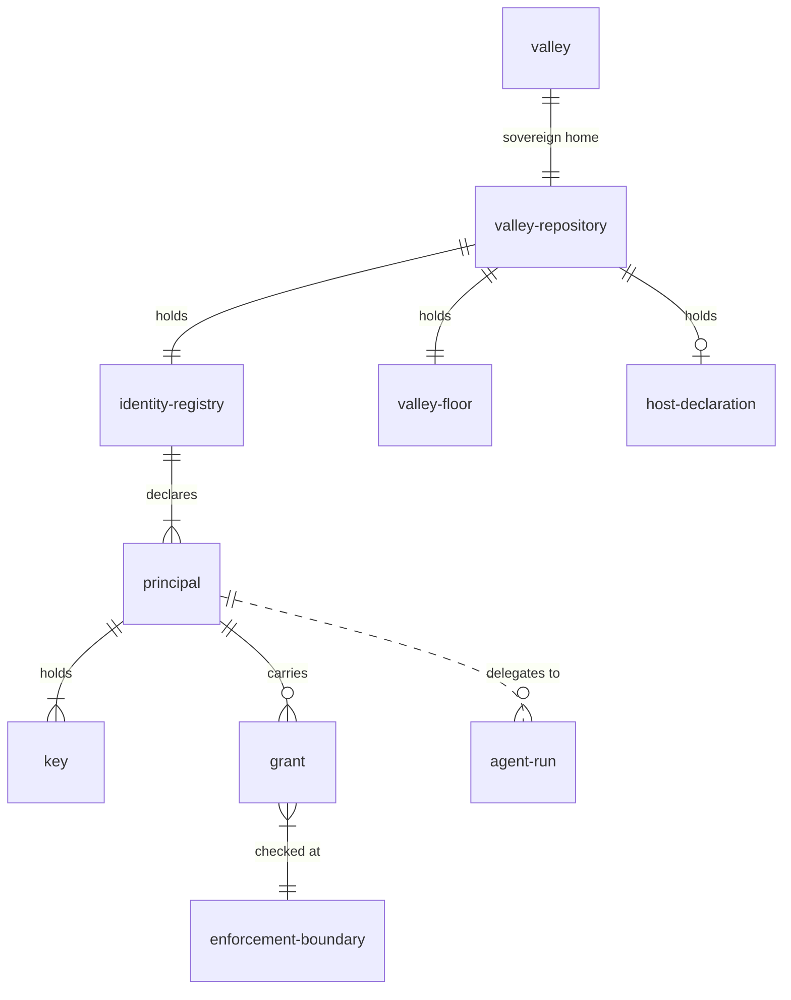
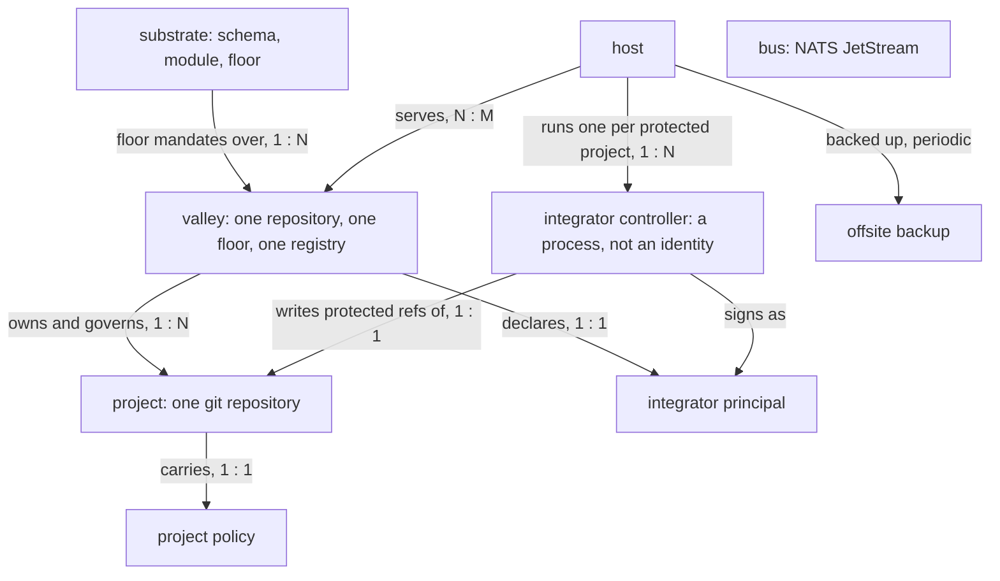
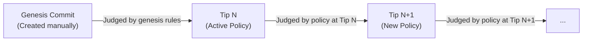

# Architecture

This document describes the architectural bets and system model of `the-valley`.

Like a natural valley that collects mountain streams without forcing their path, the architecture
favors natural data flow: content-addressed stores, durable append-only event logs, and decoupled
reactive controllers.

```
  bare git (Tailscale)  ──┐                       ┌──► nix build       (pure derivations)
  build outputs        ───┤                       │
  agent runs (klaus)   ───┼──►  event bus  ──►  subscribers ──► armstrong  (effectful reactions)
  deploy state         ───┤    (NATS JS)          │
  external signals     ──┘                        └──► integrator     (per-repo integration)

  attestations published to a transparency log on every push
```

## The concerns, unbundled

Monolithic platforms bundle disparate development concerns into a single hosted environment.
`the-valley` unbundles these concerns into modular, sovereign primitives:

| Concern               | Monolithic Status Quo                                   | The Valley Direction                                                          |
| :-------------------- | :------------------------------------------------------ | :---------------------------------------------------------------------------- |
| **Hosting**           | Centralized web forge; vendor lock-in.                  | Bare git repositories served over SSH and Tailscale on owned hardware.        |
| **Identity & Access** | Platform accounts, web sessions, RBAC matrices.         | Cryptographic SSH keys and declarative CUE identity registries.               |
| **Verification**      | Slow, brittle YAML CI pipelines on remote runners.      | Hermetic local Nix derivations generating signed attestations in seconds.     |
| **Artifacts**         | Ephemeral, proprietary CI artifact stores.              | Content-addressed, reproducible Nix derivations stored in binary caches.      |
| **Automation**        | Push-based webhooks and monolithic workflow files.      | Independent reactive controllers subscribing to a durable NATS event log.     |
| **Integration**       | Monolithic web UI merge buttons and branch protections. | Pull-based integrator controllers evaluating cryptographic evidence.          |
| **Feedback & Review** | Rigid PR pages conflating chat, gating, and record.     | Continuous event streams, derived discussion threads, and attention routing.  |
| **Project Knowledge** | Fragmented across issues, wikis, and chat channels.     | A typed markdown graph (`.the-valley/`) versioned directly in the repository. |

---

## Bet: git as event source — a log, not a workflow engine

_Serves: Automation and Observability._

Traditional CI/CD systems rely on push-based pipelines: an external event fires, an ephemeral runner
executes a procedural script, and the only persistent record is an unstructured text log.

`the-valley` uses an event-sourced architecture:

- **Causality is Preserved:** The lineage of `commit -> check -> deploy -> notification` is
  preserved as a queryable causal chain rather than scattered across dashboard tabs.
- **Independent Subscribers:** Adding, updating, or removing an automated reaction requires no
  changes to existing workflows or configuration files.
- **Deterministic Replay:** Past event streams can be replayed against new controllers for debugging
  or historical analysis.
- **Durable Ground Truth:** Repository ref updates and signed attestations are stored durably in
  git. The event bus is a high-speed projection over git state that can always be rebuilt from the
  underlying repository.

## Bet: attestation with revocation, not CI as gate

_Serves: Instant Verification and Agent Autonomy._

Instead of forcing code to wait in a queue for remote CI machines to re-run identical builds,
verification runs locally where the work is authored (on the developer's workstation or agent
sandbox).

When checks pass, the authoring environment signs a structured **attestation** containing the tree
digest, the check definition, and the result. The integrator checks the attestation signature and
merges immediately. Background re-verifiers cross-check attestations asynchronously. If an
attestation is ever found to diverge, trust in the signer is revoked.

This trades two failure modes:

- **CI-as-a-Gate:** Suffers from frequent false negatives (flaky networks, third-party outages, and
  slow feedback queues blocking valid changes).
- **Attestation with Revocation:** Permits transient false positives (a faulty attestation landing
  before re-verification catches it), but gains instant feedback and orders-of-magnitude faster
  throughput. For solo developers and trusted teams, this trade-off dramatically accelerates daily
  iteration.

## Bet: a pull-based integrator, not a pre-receive gate

_Serves: Integration Reliability and Uniform Failure Semantics._

Rather than blocking git pushes synchronously with a complex `pre-receive` script, `the-valley` uses
a **pull-based integrator controller**:

1. Contributors push their change and signed attestations to designated request refs:
   `refs/the-valley/integration-requests/<target>/<change>`.
2. The integrator controller observes the request ref, evaluates the change's delta against the
   target branch tip, verifies the cryptographic evidence, and updates the branch ref.
3. If an incoming change conflicts or lacks valid evidence against the new tip, it is marked
   **stale**. The failure is recorded as an outcome event in git. Refreshing the change is handled
   asynchronously by the authoring agent or human.

The bare git repository enforces only one structural invariant: **only the integrator's key may
write to protected branches, and attestation refs are create-only.** All complex merge policies live
in the integrator process.

## Bet: review is observability + feedback

_Serves: Human-Agent Collaboration and Attention Management._

The traditional "pull request" conflates four distinct functions:

1. **Coordination:** Discussing proposed changes.
2. **Gating:** Enforcing passing tests before merging.
3. **Record:** Retaining historical context for why a change occurred.
4. **Notification:** Alerting reviewers that attention is needed.

`the-valley` unbundles these functions:

- **Gating** is handled mechanically by signed attestations.
- **Record** is preserved in git commits and the transparency log.
- **Coordination** happens in typed markdown discussion nodes that persist across ref merges.
- **Notification** becomes an explicit attention-routing subsystem. Humans review code when flagged
  by policy, rather than manually approving routine, fully-verified changes.

## Bet: project knowledge is a typed-node graph

_Serves: Shared Memory for Humans and AI Agents._

All project knowledge—outcomes, decisions, bug reports, ideas, and principles—lives inside the
repository under `.the-valley/` as markdown files with structured YAML frontmatter.

- **Human-Friendly:** Readable and editable with standard text editors, `grep`, and `git log`.
- **Agent-Friendly:** Easily parsed and indexed by autonomous agents during execution.
- **Versioned & Atomic:** Decisions and bug resolutions land in the exact same git commits that
  change the source code.

## Bet: the knowledge graph read generatively — an outcome DAG

_Serves: The Autonomous Outcome Engine._

Knowledge nodes define explicit dependency relationships (`blocked_by`). By treating **outcomes**
(declarations of desired future state) as the primary units of work:

1. Root outcomes define top-level goals and carry priority.
2. Priority propagates through the dependency DAG.
3. The scheduler identifies the **unblocked frontier**—open outcomes whose dependencies are
   satisfied.
4. Autonomous agents (`klaus`) are automatically dispatched against frontier nodes to implement
   changes and submit integration requests.

## Federation: the valley is the unit



- **The Valley:** The sovereign administrative domain (a person, team, or organization). Each valley
  owns one governance repository defining its identity registry and floor policies.
- **Principal:** An authorized entity (human operator, machine runner, or controller service)
  holding one or more cryptographic keys.
- **Agent Run:** An ephemeral execution spawned under a principal's delegated authority. Agent runs
  carry signed provenance linking them back to the authorizing principal.
- **Host:** Shared compute infrastructure serving one or more isolated valleys via dedicated Unix
  users and separate key sets.



---

## Bootstrap Mechanics: Induction Over Time

Because system policies, identity registries, and host definitions are stored in repositories
governed by `the-valley`, the system unrolls bootstrap cycles as an induction over git history:



- **Rule Amendments:** The policy active at **Tip N** evaluates the change that creates **Tip N+1**.
  A policy update is validated by the old rules and takes effect on the subsequent commit.
- **Genesis State:** Every repository begins with a hand-signed genesis commit that establishes
  initial keys and verification floors.
- **Recovery Boundary:** If an integrator breaks or enters an unrecoverable state, the human
  operator can access the underlying host directly to rebase or restore from offsite backup.

---

## Reference Components

- **Hosting Substrate:** Bare git over SSH on Tailscale nodes (`classic-laddie`).
- **Event Bus:** NATS JetStream for persistent, replayable event streams.
- **Verification Engine:** Hermetic Nix derivations (`nix flake check`) and signed attestations.
- **Integrator:** A dedicated Go daemon evaluating optimistic concurrency control and branch
  updates.
- **Agent Orchestrator:** `klaus` for headless multi-agent runs in isolated git worktrees.
- **Schema Validation:** CUE for configuration, identity, and attestation schemas.
- **Transparency Backstop:** Cryptographic transparency log (Tessera / Tesseract) for tamper-evident
  attestation inclusion proofs.
