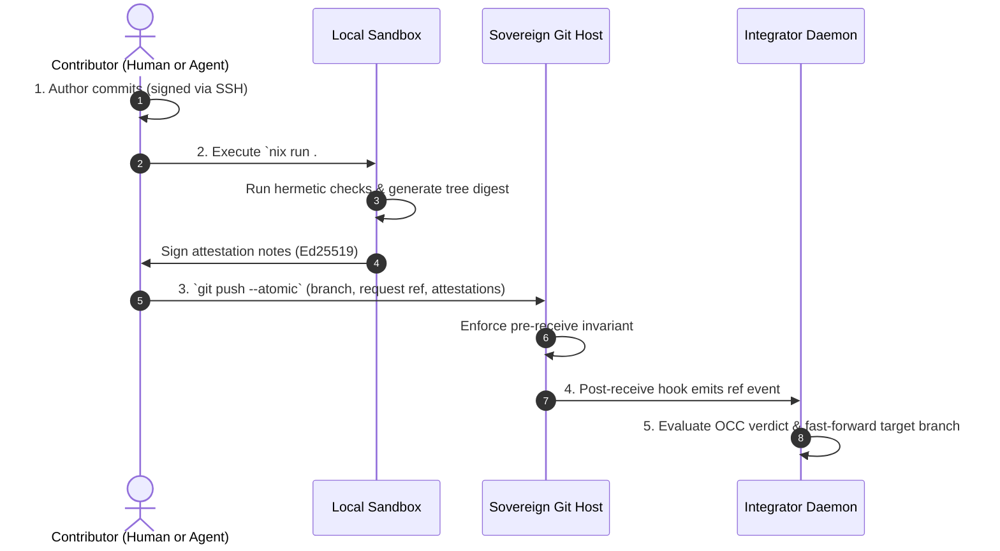

# Contributor Protocol

This document specifies the workflow for contributing code to a `the-valley` repository. It applies
identically to human developers and autonomous AI agents.

## Core Properties of a Contribution

Every contribution submitted for integration satisfies four properties:

1. **Cryptographically Attributed:** Commits and attestations are signed with known Ed25519 or SSH
   keys.
2. **Hermetically Verified:** The repository's required check suite has run and passed in a local,
   reproducible sandbox.
3. **Tamper-Evident:** Attestations are stored in git and verifiable against public transparency
   logs.
4. **Explicitly Targeted:** The change clearly specifies its target branch through an integration
   request reference.

All four properties are submitted together in a single atomic `git push` without requiring custom
git wrappers.

---

## Step-by-Step Contribution Workflow



### 1. Author and Sign Commits

Author changes on a local topic branch. Commits are signed natively using standard SSH key signing
(`git commit -S`).

### 2. Run Verification and Generate Attestations

Run the canonical verification suite using the repository helper:

```bash
nix run .#attest
```

This helper:

- Computes the `valley-tree-v1` digest over the working tree.
- Executes required checks in a clean, exported sandbox.
- Formats canonical attestation statements matching `schema/attestation.cue`.
- Signs the statements with the local host key.
- Stages attestations under `refs/the-valley/attestations/<tree-digest>/<signer-key-hash>`.

If any check fails, no attestations are generated.

### 3. Submit Integration Request via Atomic Push

Push the topic branch, its attestations, and the integration request reference atomically:

```bash
git push --atomic origin \
  feature-branch \
  refs/the-valley/attestations/* \
  HEAD:refs/the-valley/integration-requests/main/feature-branch
```

### 4. Integrator Evaluation

Upon receiving the push:

1. The bare git server verifies that the push does not directly modify protected branches
   (`refs/heads/main`).
2. The integrator daemon detects the new request reference
   `refs/the-valley/integration-requests/main/feature-branch`.
3. The integrator evaluates the delta against `main`, verifies closure-digest equality for pure
   checks, fast-forwards `main`, records the transfer statement, and consumes the request reference.

---

## Structural Git Invariant

The bare repository enforces a minimal `pre-receive` hook with two rules:

1. **Protected Branch Write Restriction:** Only the integrator daemon's key is authorized to update
   protected branches (such as `refs/heads/main`).
2. **Append-Only Attestations:** Attestation refs (`refs/the-valley/attestations/*`) are
   create-only; existing attestations cannot be overwritten or deleted.

All other branch creations and request refs are open to authorized contributors. All complex merge
policy decisions remain in the integrator daemon.
