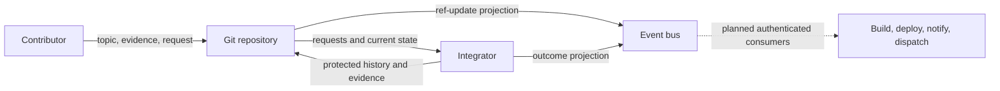

# Architecture

The-valley separates repository hosting, verification, integration, automation, and project
knowledge into components with explicit contracts. This document explains those choices and the
[requirements](./requirements.md) they serve. Detailed formats and algorithms belong in
[verification](./verification.md) and [integration](./integration.md).

The repository implements hosting, event projection, local attestations, policy derivation, an
integrator, and an identity compiler. The broader automation, product interface, and trust system
are still being developed. A decision in the graph records an adopted design; it does not establish
that every part has shipped.

## Responsibilities

| Concern             | Responsibility                                      | Current implementation or proposed direction                                                                |
| ------------------- | --------------------------------------------------- | ----------------------------------------------------------------------------------------------------------- |
| Hosting             | Keep repositories available and recoverable         | Bare Git over SSH, publication mirrors, and offsite backup                                                  |
| Identity and access | Identify principals and enforce their permissions   | A valley registry compiled into boundary-specific files; finer project permissions remain to be implemented |
| Verification        | Establish which checks passed over which inputs     | Local runners produce signed attestations; Nix is the reference runner                                      |
| Artifacts           | Preserve identifiable build results                 | Nix outputs and caches; retention policy remains open                                                       |
| Integration         | Apply policy and update protected history           | A controller evaluates requests stored as Git refs                                                          |
| Automation          | Perform and record consequences of changes          | Independent controllers; a shared event history is the proposed coordination mechanism                      |
| Feedback            | Make discussion, approvals, and problems accessible | Views over recorded work, with attention routing still to be designed                                       |
| Project knowledge   | Preserve requirements, reasoning, and work state    | Typed Markdown nodes stored with the code                                                                   |

A component can use another component's records without owning its workflow. For example, a build
controller can observe an integrated change without controlling how contributors submit changes.

## Events and reconciliation

Git records repository state. Hooks project ref updates onto the event bus so other components can
observe them. The bus currently uses NATS JetStream.

The automation design aims to connect a change, its build, its deployment, and its notifications in
one queryable history. Each controller owns its reaction and lifecycle. Adding a reaction should not
require editing every other reaction or a central workflow.

Events and reconciliation have different jobs. An event can tell a controller that something may
have changed. Reconciliation reads the current authoritative state and decides what remains to be
done. The current integrator polls request refs directly and publishes outcomes; it does not consume
bus events.

Current refs can be projected onto a new bus. That reconstructs a view of current state, not every
event that occurred. Deleted branches, overwritten refs, and external effects need their own
retained history. Replaying an effectful reaction also requires rules for avoiding repeated
deployments or notifications. Replay alone does not supply those rules.

The [signal contract](../.the-valley/decisions/dcr-62ecc36-signal-contracts.md) defines the existing
projection. [Open questions](./openquestions.md#storage-retention-and-evolution) records the
remaining durability requirements. Bus
[authentication](../.the-valley/bugs/bd-d853d9c-bus-unauthenticated.md) and
[service isolation](../.the-valley/bugs/bd-500adf7-bus-shares-git-user.md) must be addressed before
the relevant consumers or wider access are enabled.

## Verification during authorship

A contributor runs the required checks where the change is authored and publishes signed statements
of their results. Each statement identifies the checked tree and the computation or observation
being claimed. The integrator can use this evidence without running every check again.

This serves the requirement for prompt integration. It also gives a human and an agent the same
submission contract. Both must provide evidence that satisfies policy.

The trust assumption is explicit: a valid signature establishes who made a claim, not whether that
claim is true. A recognized signer can make a false claim. Independent re-verification, transparency
publication, and trust adjustment are planned ways to detect and respond to that failure. They are
not part of the current local-attestation guarantee.

This choice trades the delay of verification before every landing for the risk that a false claim
may be discovered after a change lands. Whether that trade is acceptable depends on the project and
the consequences of a bad change. Revocation can restrict future work; recovery from work already
accepted is a separate problem.

[Verification](./verification.md) defines the evidence and its limits. The
[post-landing recovery risk](../.the-valley/bugs/bd-e63bac8-cascading-revocation-on-divergence.md)
keeps the unresolved consequences visible.

## Integration through a controller

A contributor requests integration by publishing a ref that names a change and its target. A
controller reads the request, evaluates it against governing policy, and updates the protected
branch when it can.

Using a controller separates submission from the integration decision. A contributor can publish
work before it is ready to land. The controller can report missing evidence, reconsider a request
when the target changes, and retry an operational failure without holding a receive hook open.

Requests targeting the same protected ref must serialize at the ref update. The integrator checks
whether the proposed delta applies and whether each required check's evidence remains valid for the
resulting tree. It uses a compare-and-swap update so a concurrent change cannot invalidate the
decision unnoticed.

Evidence can be stale, missing, or invalid. Stale evidence names work that needs refreshing. Invalid
signatures, malformed statements, and incompatible claim types are rejected. These are different
outcomes because they require different responses from a contributor.

The integrator evaluates and compares evidence; it does not execute checks. That removes check
execution from the serialized integration step. It does not prove adequate throughput or fairness
under contention. The
[starvation risk](../.the-valley/bugs/bd-c324184-occ-starvation-under-contention.md) remains open.

### Protected refs

Only the integrator is intended to write protected refs. Contributors can create attestation refs
but cannot rewrite or delete existing ones through the receive boundary. Complex verification policy
belongs in the integrator.

The host schema can declare additional protected-ref writers, so deployment must preserve this
restriction. The
[access decision](../.the-valley/decisions/dcr-e544f20-access-is-verbs-on-projects.md) treats
integrator authority as part of the machinery, not a permission to grant to ordinary contributors.
Host root access remains outside this enforcement boundary.

Today, the remaining ref namespaces are available to callers with push access. The decided
project-scoped `push`, `fetch`, `request`, and `observe` permissions require further enforcement
work. A declaration is not a permission boundary until a component checks it.

## Review, approval, and feedback

A pull request commonly combines four needs:

| Need         | What must be available                                       |
| ------------ | ------------------------------------------------------------ |
| Coordination | Discussion connected to the relevant change or outcome       |
| Gating       | Evidence and approvals required before integration           |
| Record       | A durable account of what was decided and why                |
| Notification | A way to reach the person or agent whose attention is needed |

These needs can share records without depending on a single pull-request object. A view can show the
discussion, evidence, approval, and outcome associated with a change. The underlying records remain
accessible to other views and to agents.

Discussion and approval are distinct. An approval that authorizes a change must be a signed act with
an identifiable subject. The
[core approval decision](../.the-valley/decisions/dcr-9c75283-substrate-adoption-and-the-core.md)
requires physical human approval by default. Policy may exempt ordinary work, such as implementation
under previously approved intent. Changes to policy itself still require physical approval. The
approval mechanism must ship before that requirement is activated.

The [interface proposal](../.the-valley/ideas/ida-23aa413-project-surfaces-are-derived-views.md)
explores a product interface over these records. Attention routing remains separate: it must decide
what a person needs to see and when, without requiring them to watch every event.

## Project knowledge

The graph stores outcomes, bugs, ideas, and decisions as Markdown files with typed metadata. It
clones, changes, and receives backup with the code. Humans can read it directly, and agents can use
the same files.

The [graph conventions](../.the-valley/README.md) define the four implemented node types and their
relationships. Earlier proposals also describe discussion, principles, and configuration as nodes.
Those extensions are not in the current schema. In particular, a proposed principle does not become
an enforced requirement merely by appearing in the graph.

The graph's purpose extends beyond tracking tasks. It preserves the reasons behind decisions so a
later contributor can reconstruct the design and assess a proposed change. Keeping that reasoning
readable matters as much as keeping the metadata valid.

## Work from outcomes and dependencies

An outcome describes something someone wants to exist. Dependencies record what must be resolved
before work on it can finish.

The scheduling proposal uses this graph to choose work. A requested outcome supplies demand. Its
priority influences the work needed to satisfy it. Open outcomes whose blockers have cleared form
the set available for dispatch. An agent can then work on one of those outcomes and update the
record as it proceeds.

The current schema supports `blocked_by` and defines when each kind of blocker clears. Priority
propagation, dispatch policy, completion links, and concurrency controls are further design work.
The [outcome proposal](../.the-valley/ideas/ida-eac723e-outcome-dag.md) contains the full reasoning.

Choosing work and requesting human attention are separate decisions. One asks what can make progress
toward a requested outcome. The other asks which uncertainty or stalled decision needs a person.
Continuing demand also requires limits on retries and total spending; the
[unbounded-work risk](../.the-valley/bugs/bd-5cb2034-unbounded-loops-under-demand-pressure.md)
describes the failure to avoid.

## Valleys, projects, and hosts

A **valley** is a set of people, machines, services, and projects governed together. It has a
repository containing its identity registry and shared policy. A project belongs to one valley and
currently has one Git repository.

A host provides the machinery serving those repositories. It does not define the valley's policy.
The design allows several valleys on a host while requiring separate access and service state. A
valley spanning several hosts is deferred.

The-valley supplies common software, schemas, and policy templates. A valley adopts policy by
integrating it into its own repository. An update to supplied templates does not silently change
what a valley has adopted. The small deployed core is the explicit exception described by the
[adoption decision](../.the-valley/decisions/dcr-9c75283-substrate-adoption-and-the-core.md).

### Policy and identity

The valley's shared verification policy is called its **floor**. A project can add requirements and
choose optional defaults; it cannot remove mandatory floor requirements. Required checks come from
every path class touched by the change.

The integrator reads the floor from the valley's integrated state and the project's policy from the
target branch's integrated state. A proposed policy change is therefore judged under the rules that
precede it.
[Policy composition](../.the-valley/decisions/dcr-f41f718-declared-verification-policy.md) defines
this contract. Supplying trusted implementations of mandated checks remains a
[separate gap](../.the-valley/bugs/bd-eaefe82-check-definitions-come-from-the-branch.md).

The identity registry declares principals, their keys, and grants. Its compiler produces the files
checked at enforcement boundaries. A human, machine, or service may be recognized by several
valleys, each independently granting authority.

An agent run acts under delegated authority and has no registry key of its own. Host-signed
provenance attributes the work to the run. Recording a delegation chain does not yet verify that
chain.

### Relationships and counts

These counts describe the adopted model. The remaining work for sharing hosts is recorded in the
[host isolation decision](../.the-valley/decisions/dcr-9b5da04-hosts-serve-isolated-valleys.md).

| Relationship                    | Model                                                                                                                 |
| ------------------------------- | --------------------------------------------------------------------------------------------------------------------- |
| Valley to governing repository  | One repository per valley                                                                                             |
| Valley to registry and floor    | One registry and one adopted floor; operation under the core alone is decided but not enabled by current tooling      |
| Valley to projects              | A valley governs several projects; each project has one owning valley                                                 |
| Project to stores and policy    | One Git store today, with other stores possible; project policy is optional                                           |
| Host to valleys                 | Several valleys may share a host; one valley across several hosts is deferred                                         |
| Valley to push access           | One separate Unix push user per valley on a serving host                                                              |
| Principal to valleys            | A principal may be recognized independently by several valleys                                                        |
| Principal to keys               | A principal may have several keys, each with its own lifetime                                                         |
| Grant to enforcement            | Each grant needs a boundary that checks the permitted action and scope                                                |
| Valley to integrator identity   | One integrator principal; several controllers may sign as it                                                          |
| Controller to protected history | A controller serves a protected project or target; writes to the same target must be ordered                          |
| Agent run to authority          | The run uses delegated authority and records its provenance; it is not a new registry principal                       |
| Statement to signatures         | Several signatures may cover the same statement text                                                                  |
| Signing name to verifier key    | The name and public key jointly identify a verifier key; one raw key under two names produces two verifier identities |
| Project to mirrors              | Zero or more publication mirrors; the schema already permits a list                                                   |
| Request to landing              | A pending request may land or remain unresolved; a landed request is consumed                                         |

Valleys sharing a host must not receive one another's credentials or events by default. The bus
could be separated per valley or use authenticated subjects scoped to each valley; that choice is
open. Host administrators retain root access, so independence from an administrator requires a
separate hosting boundary.

### Bootstrap and recovery

Several parts of the system govern their own changes: the registry controls who can amend it, policy
determines how its amendments land, and a host may serve the repository that declares its
configuration.

Ordinary updates use the previous accepted state to judge the next state. The integrator records the
policy used in its transfer statement. A new rule begins governing subsequent changes after its own
adoption has passed the existing rules.

The first state is different. It must be established before these mechanisms can enforce it.
Recovery must also remain possible when the mechanism being repaired cannot operate.

| Governed component  | Initial setup                                                     | Recovery boundary                                                                                       |
| ------------------- | ----------------------------------------------------------------- | ------------------------------------------------------------------------------------------------------- |
| Registry            | Seed recognized principals before enabling compilation            | Host administration; recovery after compromise of the initial governing identity remains open           |
| Verification policy | Seed the governing repository before its integrator depends on it | Host administration and a recorded recovery procedure                                                   |
| Repository access   | Supply initial keys until the registry can compile them           | Retain the last valid artifacts after a failed compile; reject a render with no unexpired governing key |
| Host configuration  | Install the first host manually                                   | Restore from offsite backup and reapply configuration                                                   |

Retaining old compiled credentials has its own cost: a failed convergence can retain a credential
that has since expired. Recovery availability and timely revocation need to be considered together.

Introducing the integrator's own key is another bootstrap case. The intended anchor is approval by
an already authorized human, rather than relying only on the new key's signature. The complete
approval and recovery procedures remain part of the open
[self-transparency proposal](./self-transparency.md).

## Components

| Component                       | Role and status                                                                                          |
| ------------------------------- | -------------------------------------------------------------------------------------------------------- |
| Bare Git and SSH                | Current repository transport and storage                                                                 |
| NATS JetStream                  | Current ref-event projection and inspection                                                              |
| Nix                             | Reference build and verification runner                                                                  |
| CUE                             | Shared schemas for hosts, events, nodes, evidence, identity, and policy                                  |
| Integrator                      | Current request reconciliation and protected-ref updates                                                 |
| Tessera-backed transparency log | Proposed external publication and inclusion proofs for Phase 6                                           |
| Armstrong                       | Proposed controller for builds and external effects                                                      |
| Klaus                           | Existing agent orchestrator to adapt to valley outcomes and integration                                  |
| Repository and graph interface  | Product work proposed in the graph; browsing, editing, and review should use the same underlying records |

These choices can be revised as the [roadmap](./roadmap.md) tests them. The schemas and observable
contracts are intended to outlast any one implementation.
